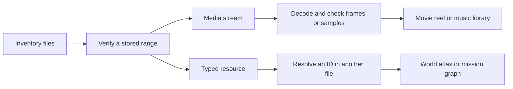

# GTA VI Port Research

**What can you recover from GTA VI's Xbox data, and how do you prove what you found?** Project NATIVE maps the path from stored bytes to a playable clip, an identified resource, or a testable claim about the game.

**[Run a tool](#run-your-first-inspection)** · **[Find a file type](#data-map-at-a-glance)** · **[Explore related repos](research/tool-atlas.md)** · **[Pick an experiment](#ten-things-to-build-from-the-data)**

For what the executable sections, shader tables and gameplay records can tell us about the engine, read the [engine evidence assessment](research/engine-evidence.md). It also documents the [offline media browser](tools/media_library.py) for existing video and audio inventories.

## Run your first inspection

### Use the console companion

Build a single offline page to use beside your console. It opens with catalog names hidden. Choose a replay entry to make a **before-you-advance checklist**, **compare two decisions** from a recorded starting state, or **track replay availability** as it appears on your console. The **interior scout** ranks nearby placements by straight-line distance. The **encounter log** pairs a schedule lead with the time, place and activity you observed.

```powershell
python tools/console_companion.py path/to/people/evidence.json path/to/world/interiors.csv path/to/private/console-companion.html
```

To add the **minigame checklist**, pass `--activities path/to/activities/companion.json`. This optional local JSON array supplies a display name, classification and evidence summary for each entry (fields `name`, `classification`, and `evidence`). Players can mark personal sightings and carry them over in a journal backup. An optional `details` object maps headings to evidence summaries. An optional `objectives` object maps stable IDs to checklist labels. Players can tick those objectives independently and restore them from backup. Use `displayName` when a verified display title differs from a previously indexed name. To link a local art or evidence report, set `evidencePage` to its relative HTML path under the output folder, optionally followed by a section anchor.

Open the generated HTML on your companion device. The builder expects the local people workbench's mission and schedule groups and the world inspector's interior CSV. Notes live in that browser. Use **Download journal backup** to move them to another device, then restore against the same catalogs. Replay catalog keys identify entries. Verifying a choice consequence requires observed outcomes from comparable saves. [Builder](tools/console_companion.py) · [Offline interface](tools/console_companion.html)

### Inspect files

From the repository root, with Python 3.9 or later:

```powershell
python tools/inventory.py tools --sha256
```

This reads the tools in your checkout and prints one JSON object per file with `path`, `bytes`, and `sha256`. Replace `tools` with the path to your own local package to produce the same inventory for that directory. Omit `--sha256` for a quick listing that reads file metadata. [Inventory source](tools/inventory.py)

## From bytes to a finding



## Data map at a glance

| If you are looking at… | What to trace | Open this file |
|---|---|---|
| Package configuration (`.xml`, `.config`) | Target device family → declared executable → file actually present. Record an absent entry before investigating launch. | [Package, code and storage](research/data-types.md#package-code-and-storage) |
| Executables and libraries (`.exe`, `.dll`) | PE header → machine type and entry RVA → ordinary import providers. A provider name narrows the dependency search; call behavior still needs a runtime test. | [PE inspector](tools/inspect_pe.py) · [Xbox launch diagram](research/xbox-to-pc.md#2-follow-xbox-startup) |
| Archives and streaming containers (`.rpf`, `.ttpf`) | Directory row → predicted stored range → independently verified end → resource type. For a streaming index, check each boundary against the containing file before assigning asset names. | [Compressed-stream reader](fixture/rpf.py) · [Directory probe](fixture/directory_probe.py) · [Storage research status](research/data-types.md#package-code-and-storage) |
| World, interiors, props and vehicles | Placement → archetype → drawable → material and texture. Count placements and distinct models separately: a street can contain many instances of one prop. | [World and movement report](research/data-types.md#rendering-world-and-movement) |
| Shaders and pipeline states | Pipeline → referenced shader → bindings → draw or compute output. Several pipelines can reuse one shader. | [Rendering report](research/data-types.md#rendering-world-and-movement) · [Rendered-frame diagram](research/xbox-to-pc.md#4-follow-one-rendered-frame) |
| Characters, clothing and animation | Spawn or schedule → character identity → model and rig → wearable slot or animation clip. A schedule ID alone cannot identify a unique NPC. | [Character and clothing report](research/data-types.md#characters-stories-and-media) · [Animation](research/data-types.md#rendering-world-and-movement) |
| Missions, scripts and choices | Replay ID → typed reference → executable event → observed state change. A branch needs a condition and distinct reachable outcomes. | [Story and script report](research/data-types.md#characters-stories-and-media) |
| Movies, music and dialogue | Video container → frame index and audio tracks; audio event → bank → stream. A title or scene assignment needs an independent link to that media. | [Media inspection workflow](research/handbook.md#a-repeatable-media-check) · [Media research status](research/data-types.md#characters-stories-and-media) |

The linked Python files are runnable tools. The reports document methods, public GTA V references, what Project NATIVE has demonstrated, and the evidence still needed. Build-specific inventories and extracted media stay local.

## Ten things to build from the data

The first two workflows have produced usable local media. For the remaining ideas, the final column is the test that would turn a promising match into a research result. Tool choices and their limits are in the [research tool atlas](research/tool-atlas.md).

| # | What you could make | What would prove it works |
|---:|---|---|
| 1 | **A movie reel** from Bink clips, with alternate audio and transparency preserved | Compare source and MP4 frame counts, track IDs and timing; check a decoded color frame and alpha mask. |
| 2 | **A music library** with playable tracks and a separate shelf for unnamed candidates | Join a structured title to a bank stream and verify the full decoded sample count. |
| 3 | **An interior atlas** linking world placements to named rooms and buildings | Resolve a placement to an archetype, then verify its transform against an independent spatial reference. |
| 4 | **A prop catalog** that counts models separately from placements | Trace two placed objects to the same drawable and verify its mesh, material and LOD. |
| 5 | **A wardrobe browser** grouped by garment, slot and colorway | Resolve two variants to a common item and compatible body rig. Shop labels alone cannot identify garments. |
| 6 | **A pedestrian schedule explorer** showing when and where a role is configured | Join a schedule to a spawn definition and a stable identity. Keep shared schedules visible. |
| 7 | **A mission replay index** with a graph of evidenced choices | Link a replay ID to an event. Add a branch only when a condition and both successor states are verified. |
| 8 | **An animation preview library** for characters and props | Bind a clip to the intended skeleton and check rest pose, joint order, root motion and duration. |
| 9 | **A collision and navigation inspector** for one city block | Validate polygon bounds and adjacency, then compare a path and collision contact with a reference. |
| 10 | **A shader coverage map** that shows which pipelines reuse the same program | Resolve pipeline indices to code ranges and validate one compute buffer or rendered draw on PC. |

## Inspect a Windows executable

```powershell
python tools/inspect_pe.py "$env:WINDIR\System32\notepad.exe"
```

This reads the installed binary without launching it. Look at `machine`, `entry_point_rva`, and `ordinary_import_providers`. A declared delay-import directory is flagged separately. Compare the result with Microsoft's DUMPBIN using the [executable walkthrough](research/xbox-to-pc.md#1-inspect-an-executable-already-on-your-machine).

## Verify a compressed-stream boundary

Try the checks immediately with `python -m unittest fixture.test_rpf fixture.test_directory_probe -v`. On your own archive, start with an offset predicted by a directory row or supplied by the packer. The probes take an offset as input; they do not discover the archive's directory.

With a local archive and a candidate **16-byte-aligned stored offset**, choose the probe that matches your hypothesis. Substitute your own file and offsets.

```text
python -m fixture.rpf FILE OFFSET
python -m fixture.rpf FILE OFFSET --paged
python -m fixture.directory_probe FILE TABLE_START TABLE_END --base 0 --unit 1 --stride 9 --count COUNT
```

- **Adjacent streams:** the first command checks two zlib checksums and their alignment padding, then prints both half-open stored ranges.
- **Paged resource:** the second follows full 64 KiB decoded pages through a short final page. It reports stored span, decoded size, and page count.
- **Directory hypothesis:** the third reads candidate offset/length pairs from consecutive rows before inspecting their payloads. Both predictions must agree with independently measured stream ends. The base, unit, and stride shown are hypotheses to test against the candidate layout. Retail RPF9 tables use 9- or 10-byte rows (low byte at `0x2c` is 1 or 2), padded to a multiple of 16. Pass the entry count from `0x24` as `--count` to reject a stride that does not fill the table exactly.

A passing checksum identifies an intact stream. To identify the asset inside it, parse the decoded structure and cross-check an independent name, index, or typed reference. [Stream tests](fixture/test_rpf.py) · [Directory tests](fixture/test_directory_probe.py)

## What runs on PC today?

The public tools perform static inspection. The desktop GDK sample has rendered a Direct3D 12 frame; a GTA VI gameplay frame on Windows remains unverified. Start with the [desktop build and capture](demo/gdk/README.md) for the graphics result, the [research handbook](research/handbook.md) for the full tool directory, or the [executable intake playbook](research/first-72-hours.md) for the porting milestones. Run `python harness.py` to verify the repository tests.

Project NATIVE is independent of Rockstar Games, Take-Two Interactive, and Microsoft. Contributions should contain original tools, diagrams, or links to public documentation. Keep game files, extracted assets, keys, download links, and private inventories off GitHub.
